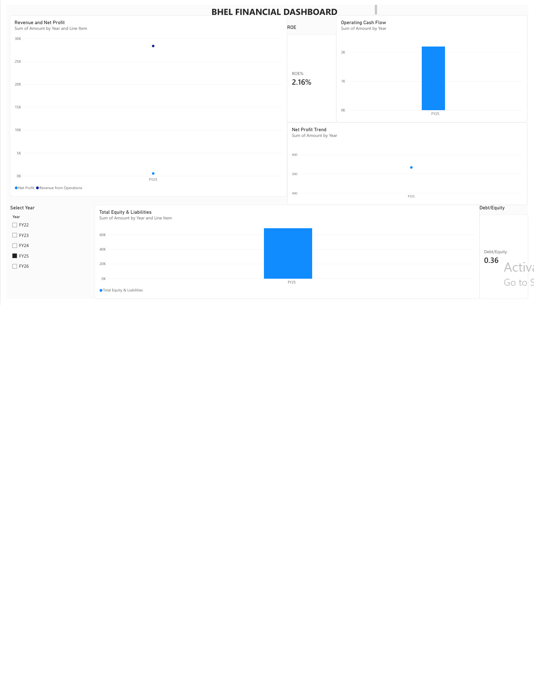

# BHEL Financial Dashboard (Power BI)

An interactive Power BI dashboard analysing the financial performance of Bharat Heavy Electricals Limited (BHEL) for FY22-FY26, built with Power Query and DAX.

## Dashboard preview

*All years (FY22-FY26)*

*Single year (FY25) using the year selector*

## What the dashboard shows
- Revenue and net profit trend, FY22-FY26
- Net profit trend
- Operating cash flow by year
- Total equity and liabilities by year
- Return on equity (ROE) and debt-to-equity (D/E) cards
- Year selector to switch between all years and any single year

## Key findings
- Revenue grew from about 21,200 crore (FY22) to about 33,800 crore (FY26).
- Net profit dipped in FY24 and then recovered strongly by FY26.
- Operating cash flow was negative in FY23 and FY24 and turned positive from FY25.
- ROE stays low (about 2.8% across the five years), and debt-to-equity is about 0.29.

## Tools used
- Power BI Desktop
- Power Query (data cleaning and transformation)
- DAX (measures such as ROE and debt-to-equity)

## Files
- bhel dashboard.pbix: Power BI file
- bhel dashboard.pdf: PDF export of the dashboard
- DASHBOARD-ALL-YEARS.PNG and DASHBOARD-F25-YEAR.png: screenshots

## Related project
[BHEL Financial Model (Excel)](https://github.com/srikarpatel2002-design/excel-bhel-financial-model). The dashboard's ROE and debt-to-equity figures match the Excel model.
