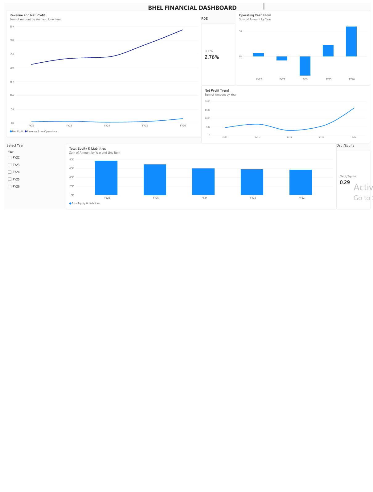

# BHEL Financial Dashboard (Power BI)

Interactive Power BI dashboard analysing BHEL financials for FY22 to FY26.

## Key visuals
- Revenue and Net Profit trend
- Net Profit trend
- Operating Cash Flow
- Total Equity & Liabilities
- ROE and Debt/Equity cards
- Year slicer controlling all visuals

## What I did
- Cleaned and reshaped data in Power Query (removed junk rows, promoted headers, unpivoted year columns, handled errors)
- Built a Year dimension table with relationships so one slicer filters every visual
- Wrote DAX measures (e.g. ROE %)
- Designed the dashboard layout

## Tools
Power BI Desktop, Power Query, DAX, Excel

## Files
- bhel dashboard.pbix: Power BI file
- bhel dashboard.pdf: PDF export
- DASHBOARD-ALL-YEARS.PNG, DASHBOARD-F25-YEAR.png: screenshots

## Note
The data comes from a template with sample/illustrative values. It is not BHEL's reported financials.
